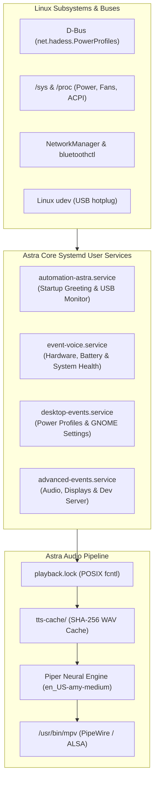

# Astra Desktop Automation

[](LICENSE)
[](https://ubuntu.com)
[](https://www.python.org/)
[](https://github.com/rhasspy/piper)
[](#privacy--security)

**Astra** is an open-source, privacy-first voice automation daemon for Linux (optimized for Ubuntu/GNOME). It monitors hardware telemetry, power profiles, desktop settings, network interfaces, and developer workflows—announcing critical transitions and daily summaries in real time with high-quality, offline neural speech synthesis.

---

## Table of Contents

- [Features](#features)
- [Architecture](#architecture)
- [System Requirements](#system-requirements)
- [Quick Start Installation](#quick-start-installation)
- [Manual Step-by-Step Installation](#manual-step-by-step-installation)
- [Configuration & Personalization](#configuration--personalization)
- [Command Line Usage](#command-line-usage)
- [Service Management](#service-management)
- [Event Ownership Matrix](#event-ownership-matrix)
- [Audio Pipeline & Caching](#audio-pipeline--caching)
- [Troubleshooting](#troubleshooting)
- [Uninstallation](#uninstallation)
- [Contributing](#contributing)
- [License](#license)

---

## Features

### 🎙️ 100% Offline Neural Speech
- Powered by [Piper TTS](https://github.com/rhasspy/piper) using local ONNX neural voice models.
- **Zero cloud telemetry, zero API keys, and zero external network calls** for audio synthesis.
- Ultra-low latency playback powered by `mpv` and PipeWire/PulseAudio.

### 🚀 Intelligent Startup Summary
- Greeting dynamically tailored to the time of day (`Good morning`, `Good afternoon`, `Good evening`, `Good night`).
- Announces the current local day, date, and time, for example: `Today is Sunday, October 11, 2026. The time is 12:50 PM.`
- Reads live system telemetry on login/boot:
  - Charger connection and current power supply status
  - Active power profile (`Performance`, `Balanced`, `Power-saver`)
  - Live battery percentage
  - Wi-Fi connection and signal readiness
  - Connected Bluetooth devices count

### ⚡ Instant Desktop & Power Mode Monitoring
- Real-time **D-Bus signal monitoring** for `net.hadess.PowerProfiles` (`performance`, `balanced`, `power-saver`) with sub-millisecond reaction time.
- GNOME Dark / Light style transitions.
- Night Light toggles.
- Airplane mode and wireless radio block tracking.

### 🔋 Battery & Hardware Health
- Immediate announcement upon plugging or unplugging the charger.
- Battery threshold alerts (20% warning, 10% critical, and 100% full charge).
- High temperature, CPU load spikes, RAM exhaustion, and low disk space warnings.
- Screen lock and unlock detection.

### 💻 Developer Workflow & Build Notifier
- **`auto-run` tool**: Wrap any command (e.g. `auto-run npm run build` or `auto-run cargo test`) to get spoken feedback upon completion or failure.
- Background detection of local development servers (`Vite`, `Next.js`, `Uvicorn`, `Flask`, etc.).
- Browser download completion tracking (`.crdownload`, `.part`).

### 🔒 Serialized Audio Playback
- Audio concurrency is synchronized via a cross-process POSIX file lock (`playback.lock`), guaranteeing that alerts never speak over each other.

---

## Architecture

Astra is split into four decoupled user services orchestrated via `systemd --user`. This multi-service architecture guarantees fault isolation and eliminates duplicate alerts.



---

## System Requirements

- **Operating System:** Ubuntu 22.04 LTS / 24.04 LTS, Debian 12+, or GNOME-based Linux distributions.
- **Init System:** `systemd` with user session support (`systemd --user`).
- **Python:** Python 3.10, 3.11, 3.12, 3.13, or 3.14.
- **Audio:** PipeWire or PulseAudio with `mpv` installed.

### System Packages

```bash
sudo apt-get update
sudo apt-get install -y \
  python3 python3-venv python3-pip \
  mpv curl rfkill network-manager bluez \
  power-profiles-daemon libasound2
```

---

## Quick Start Installation

You can install and activate Astra in one command using the included automated installer:

```bash
# 1. Clone the repository into ~/Automation
git clone https://github.com/your-username/Astra-Desktop-Automation.git ~/Automation
cd ~/Automation

# 2. Run the installer
chmod +x install.sh
./install.sh
```

The script will automatically:
1. Verify and install missing system dependencies via `apt-get`.
2. Provision a dedicated Python virtual environment (`piper-venv`).
3. Download the Piper neural ONNX voice model.
4. Pre-warm the voice cache for instant playback.
5. Install and enable the four `systemd --user` service units.

---

## Manual Step-by-Step Installation

If you prefer installing manually without running the install script:

### 1. Set Up the Virtual Environment

```bash
cd ~/Automation
python3 -m venv piper-venv
piper-venv/bin/pip install --upgrade pip
piper-venv/bin/pip install -r requirements.txt
```

### 2. Download the Neural Voice Model

Astra defaults to the expressive `en_US-amy-medium` Piper model:

```bash
mkdir -p ~/Automation/tts-models
cd ~/Automation/tts-models

curl -L -o en_US-amy-medium.onnx \
  "https://huggingface.co/rhasspy/piper-voices/resolve/main/en/en_US/amy/medium/en_US-amy-medium.onnx"

curl -L -o en_US-amy-medium.onnx.json \
  "https://huggingface.co/rhasspy/piper-voices/resolve/main/en/en_US/amy/medium/en_US-amy-medium.onnx.json"
```

### 3. Pre-warm the Audio Cache

Generate static audio files for instant, zero-latency system responses:

```bash
cd ~/Automation
chmod +x events.py scripts/*.py bin/*
~/Automation/piper-venv/bin/python ~/Automation/scripts/warm-voice-cache.py
```

### 4. Install and Enable Systemd Services

Copy the provided unit templates into your user systemd directory:

```bash
mkdir -p ~/.config/systemd/user
cp ~/Automation/systemd/*.service ~/.config/systemd/user/

# Reload systemd and enable all units
systemctl --user daemon-reload
systemctl --user enable --now \
  automation-astra.service \
  event-voice.service \
  desktop-events.service \
  advanced-events.service
```

---

## Configuration & Personalization

### Customizing the Assistant Greeting Name
By default, Astra addresses the user as `Avinash`. You can customize this by setting the `ASTRA_USER` environment variable in your `~/.bashrc` or `~/.profile`:

```bash
export ASTRA_USER="Commander"
```

To persist this inside the systemd service, edit `~/.config/systemd/user/automation-astra.service`:

```ini
[Service]
Environment="ASTRA_USER=Alex"
```

### Changing Voice Models
Astra is compatible with all Piper ONNX voice models.
1. Download any `.onnx` and `.onnx.json` model file from the [Piper Voice Library](https://github.com/rhasspy/piper/blob/master/VOICES.md).
2. Save both files inside `~/Automation/tts-models/`.
3. Update the `VOICE` constant in `events.py` and `scripts/*.py`:
   ```python
   VOICE = "en_GB-alan-medium"
   ```

### Tuning Thresholds
Limits can be adjusted directly in `events.py` and `scripts/event-voice.py`:

```python
BATTERY_WARNINGS = (20, 10)  # Battery percentage warnings
CPU_LIMIT = 85               # CPU threshold (%)
RAM_LIMIT = 85               # RAM threshold (%)
TEMP_LIMIT_C = 80            # Temperature threshold (°C)
DISK_LIMIT = 85              # Disk usage threshold (%)
```

---

## Command Line Usage

Astra includes rich CLI utilities for manual execution and scripts:

### Test the Startup Greeting
```bash
python3 ~/Automation/events.py --startup
```

### Speak an Ad-hoc Message
```bash
python3 ~/Automation/events.py --say "System update finished successfully."
```

### Build & Test Auto-Notifier (`auto-run`)
Run long builds, test suites, or scripts and have Astra announce the outcome:

```bash
~/Automation/bin/auto-run make build
~/Automation/bin/auto-run pytest
```

---

## Service Management

All Astra services run under your personal systemd user session:

```bash
# Check status of all monitors
systemctl --user status automation-astra.service event-voice.service desktop-events.service advanced-events.service --no-pager

# Restart all services
systemctl --user restart automation-astra.service event-voice.service desktop-events.service advanced-events.service

# Stop all services
systemctl --user stop automation-astra.service event-voice.service desktop-events.service advanced-events.service

# Follow live log stream
journalctl --user -f \
  -u automation-astra.service \
  -u event-voice.service \
  -u desktop-events.service \
  -u advanced-events.service
```

---

## Event Ownership Matrix

To prevent audio collisions and duplicated messages, events are strictly partitioned across the services:

| Event Category | Monitored Signals | Owning Service |
| :--- | :--- | :--- |
| **Startup Summary** | Time-of-day greeting, local day/date/time, charger, power mode, Wi-Fi, Bluetooth, Battery % | `automation-astra.service` |
| **USB Devices** | USB connect/disconnect via `pyudev` netlink | `automation-astra.service` |
| **Power Supply** | AC plug/unplug, battery thresholds (20%, 10%, 100%) | `event-voice.service` |
| **Network Interfaces** | Wi-Fi connect/disconnect (`nmcli monitor`), Bluetooth devices | `event-voice.service` |
| **System Health** | High CPU, high RAM, critical temp, low disk | `event-voice.service` |
| **Power Profiles** | Performance, Balanced, Power-saver via D-Bus | `desktop-events.service` |
| **Desktop Settings** | GNOME Dark/Light style, Night Light, Airplane mode | `desktop-events.service` |
| **Audio Subsystem** | Audio sink changes, microphone inputs, volume mute | `advanced-events.service` |
| **Display & Session** | Screen lock/unlock, external monitors, brightness | `advanced-events.service` |
| **Developer Tools** | Dev servers (`vite`, `next`, `flask`, etc.), completed downloads | `advanced-events.service` |

---

## Audio Pipeline & Caching

1. **Hash Verification:** Every phrase is hashed with SHA-256 (e.g. `e24c16c5...wav`).
2. **Instant Playback:** If the file exists in `tts-cache/`, Piper is skipped and audio plays instantly via `mpv`.
3. **On-the-fly Synthesis:** Dynamic phrases (e.g. dynamic battery percent or custom `--say` messages) are synthesized on the fly via Piper and added to the cache.
4. **Playback Lock:** An advisory `fcntl.flock` ensures sequential, interruption-free speech across all concurrent monitors.

---

## Troubleshooting

### Performance Mode Changes Not Announcing
- Astra listens directly to `net.hadess.PowerProfiles` on the system D-Bus.
- Ensure `power-profiles-daemon` is running:
  ```bash
  systemctl status power-profiles-daemon
  ```
- Test setting a profile manually:
  ```bash
  powerprofilesctl set performance
  ```
- Check logs:
  ```bash
  journalctl --user -u desktop-events.service -n 50 --no-pager
  ```

### No Audio Output
- Verify that `mpv` can play files through your sound server:
  ```bash
  mpv --no-video ~/Automation/tts-cache/*.wav
  ```
- If PipeWire or PulseAudio is muted, inspect volume via `pactl info` and `pactl get-sink-mute @DEFAULT_SINK@`.

### USB Announcements Not Working
- Ensure `pyudev` is installed in the virtual environment:
  ```bash
  ~/Automation/piper-venv/bin/python -c "import pyudev; print('pyudev is installed')"
  ```

---

## Uninstallation

To cleanly stop, disable, and remove Astra systemd user services:

```bash
cd ~/Automation
chmod +x uninstall.sh
./uninstall.sh
```

---

## Contributing

Contributions from the open-source community are welcome!
1. Fork the repository.
2. Create a feature branch (`git checkout -b feature/new-monitor`).
3. Validate Python syntax:
   ```bash
   python3 -m py_compile events.py scripts/*.py
   ```
4. Commit your changes (`git commit -m 'Add support for new sensor'`).
5. Push to your branch and open a Pull Request.

---

## License

This project is licensed under the **MIT License** — see the [LICENSE](LICENSE) file for details.
